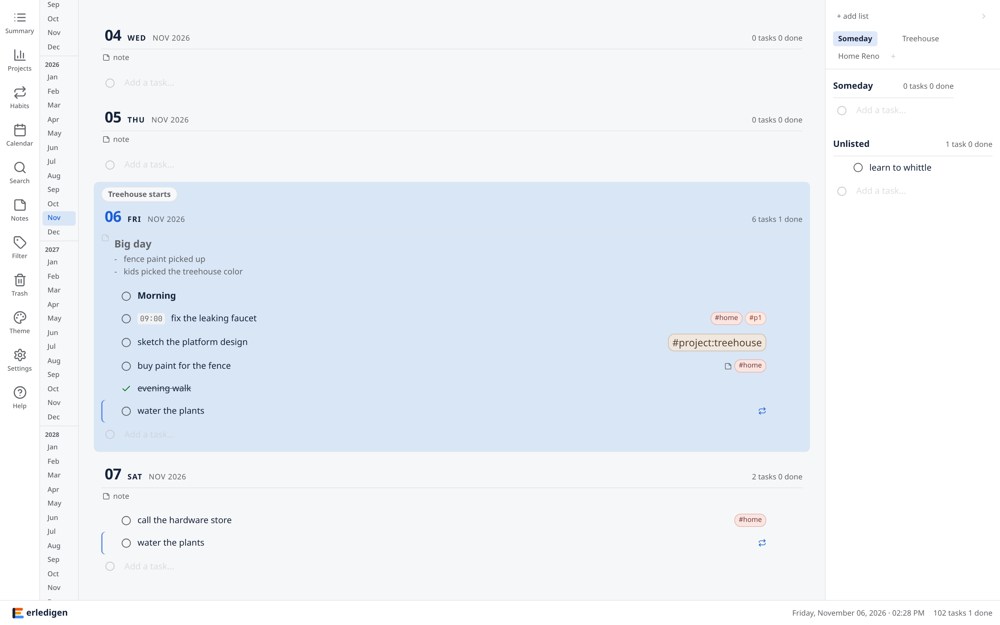

# Erledigen

**A paper calendar that fills itself in.** "Erledigen" is German for
*to get done*.

Erledigen is a day list you write by hand, plus an engine that fills in
everything that recurs -- and never moves your handwriting. Type "water
plants every friday at 9am" once, and it is simply there, every Friday,
on time. Park "learn to sail" in the Someday panel, and it waits,
unhurried, until you give it a day. Organize everything with tags you
invent -- `#p1`, `project:garage`, `#errands` -- and one filter covers
all of it.

It is self-hosted: your tasks live in your own SQLite database, every
change syncs live to every open window, and everything exports to JSON
you can restore anywhere. No accounts, no analytics, no telemetry.

[](https://github.com/funkybooboo/erledigen/actions/workflows/ci.yml)
[](./LICENSE)



## The idea

The best task manager ever made is a paper calendar: one page per day,
written in your own hand, honest about what actually happened. Its only
flaws are that it forgets your routines, it loses your someday ideas, and
it cannot search itself.

Erledigen is that calendar, automated. You write the days; the engine
remembers the rest. Habits arrive in the daily list on their own
schedule, Someday ideas stay parked until you drag them onto a day, and
no line you write is ever rewritten by a machine. The calm, spacious
layout is a nod to [TeuxDeux](https://teuxdeux.com).

## What you get

*   **A scrolling daily list** -- the primary working surface. Days stack
    and load as you scroll, you add and edit inline, and a month minimap
    keeps you oriented.
*   **A Someday panel** -- the capture net for unscheduled work, organized
    into tag-based lists you invent yourself; drag-to-resize, collapsible
    with `Cmd/Ctrl+\`.
*   **Habits that fill themselves in** -- type "water plants every friday
    at 9am" once, in any add input or the Habits modal; instances appear
    on their schedule with streaks and a completion heatmap.
*   **Markdown that renders as you write** -- task titles, task notes, and
    each day's margin note are live markdown: only the line under your
    cursor shows raw syntax, everything else renders.
*   **Tags instead of settings** -- `#p1`/`#p2`/`#p3` priority,
    `project:`-prefixed project tags, and any free-form tag you make up;
    one filter covers everything, and there is nothing else to configure.
*   **Keyboard-first, hover-taught** -- every action has a key: vim-style
    navigation, `g`-sequences for modals, priority keys `1`/`2`/`3`/`0`,
    `Cmd/Ctrl+Z` undo. Hover anything to learn its binding.
*   **Live sync, your data** -- every change broadcasts instantly to every
    connected window; a canonical JSON snapshot of everything exports and
    restores on a fresh instance.

And the details that make a daily list livable: sub-tasks with completion
roll-up, incomplete tasks that roll forward marked *late*, project
milestones, holidays with `.ics` import, a soft-delete trash, themes and
accent schemes. The [user docs](./docs/use/README.md) cover all of it.

## One grammar everywhere

Every input -- day list, Someday panel, command palette -- speaks the
same language: text first, then qualifiers.

| You type | You get |
|----------|---------|
| `buy milk tomorrow` | A task on tomorrow's list |
| `team sync next monday #p1` | A task on next Monday, priority `#p1` |
| `stretch daily at 8am` | A habit, with instances every day at 8:00 |
| `/go next monday` | The list scrolled to next Monday |

## Your data stays yours

No accounts, no analytics, no telemetry -- in any deployment mode. That
is [a written promise](./docs/use/privacy.md), not a default setting that
could change. Everything lives in your own SQLite database, and one JSON
export captures all of it. Moving in is easy too: import from Todoist,
Things 3, CSV, and iCal.

## Run it

### Self-hosted

Any Docker host, one published port, data in a named volume:

```bash
git clone https://github.com/funkybooboo/erledigen.git
cd erledigen
docker compose -f compose.prod.yaml up -d --build
```

Open `http://localhost:8080` (override the port with `PROD_PORT`). A
Caddy reverse proxy fronts the whole stack, SQLite persists in the
`prod-data` volume, and prebuilt images are published to GHCR on every
release if you would rather not build. `docker compose -f
compose.prod.yaml down` stops the stack and keeps your data.

### Development

This project uses [mise](https://mise.jdx.dev) as its task runner and
tool version manager. Install it first, then:

```bash
mise run install   # dependencies
mise run dev       # docker dev stack: client on :3000, server on :4000
```

#### Common tasks

| Command | What it does |
|---------|--------------|
| `mise run dev` | Start the docker dev stack (server + client) |
| `mise run prod` / `prod-stop` | Build + start / stop the docker prod stack |
| `mise run dev-refresh` | Rebuild dev images after changing dependencies |
| `mise run nuke-db` | Permanently delete the dev or prod database volume |
| `mise run lint` / `format` | Biome lint / format (auto-fix) |
| `mise run type-check` | Type-check all packages |
| `mise run test` | Run all unit tests in a container |
| `mise run test-e2e` | Playwright e2e + api tests in the docker test stack |
| `mise run build` | Build all packages + client bundle-size budget |
| `mise run ci` | Full local CI mirror |
| `mise run doctor` | Pre-flight environment check |
| `mise run release` | Cut a release: gates + version bump + PR + tag |

App-running tasks (dev, prod, tests) execute in containers and never
touch your host environment. The [full task list](./docs/build/process/getting-started.md)
lives in the developer docs.

## Docker

One multi-stage `Dockerfile` at the repo root; compose picks the stage via
`build.target`:

| Stage | Used by | What it is |
|-------|---------|------------|
| `development` | dev stack, test services | bun + workspace deps + source |
| `production-server` | prod stack | minimal bun runtime + server bundle |
| `production-client` | prod stack | node runtime + SvelteKit adapter-node build |
| `e2e` | e2e runner (test stack) | mcr.microsoft.com/playwright + bun + source |

**Dev** (`compose.yaml`): source is bind-mounted, so code edits are picked
up live -- no rebuild needed. The dev DB lives in the `dev-data` named
volume, never in the repo.

**Prod** (`compose.prod.yaml`): built artifacts only, behind a Caddy
reverse proxy on a single port (default 8080). Client and API are
same-origin by default; pass an absolute `VITE_API_URL` build arg for a
split-origin deployment.

**Tests** (`compose.test.yaml`): fully self-contained -- no bind mounts,
no published ports, `STORAGE_ADAPTER=memory`, Chromium bundled in the
runner image.

Version pins to keep in sync: `BUN_VERSION` in the `Dockerfile` must match
`[tools] bun` in `mise.toml`; `PLAYWRIGHT_VERSION` must match the
`@playwright/test` version in `bun.lock`.

## Layout

```
erledigen/
|-- packages/
|   |-- client/   # SvelteKit frontend (scoped CSS, Svelte 5 runes)
|   |-- server/   # Bun REST API + WebSocket server
|   \-- shared/   # Types, adapter interfaces, constants, universal utilities
|-- docs/         # User + developer documentation, ADRs
|-- tests/        # Playwright e2e + api suites
|-- tools/        # Build, test, release, and maintenance scripts
|-- deploy/       # Caddy edge proxy for the prod stack
|-- plans/        # Roadmap and planning docs
\-- package.json
```

Client and server both talk to `@erledigen/shared` -- the same Zod-driven
types and the same adapter interfaces, so the API contract cannot drift
between the two sides. Testing: Bun unit tests, Playwright e2e + api,
Storybook for components; Biome for lint and format.

## Documentation

*   [User docs](./docs/use/README.md) -- introduction, design, notes,
    keyboard reference, import/export, privacy
*   [Architecture](./docs/build/architecture/architecture.md) -- how the
    app is built, and the surprising domain facts
*   [Getting started](./docs/build/process/getting-started.md) -- setup
    and every task
*   [Code standards](./docs/build/standards/code-standards.md) -- how
    the code is written
*   [Testing](./docs/build/standards/testing.md) -- the three test layers
*   [Git workflow](./docs/build/standards/git-workflow.md) -- worktrees,
    PRs, commits
*   [Roadmap](./plans/roadmap.md) -- release-by-release development plan

## Contribute

This is a personal project, published openly -- you are welcome to hack
on it. Start with [CONTRIBUTING.md](./CONTRIBUTING.md), then the
[getting started guide](./docs/build/process/getting-started.md).

## License

Erledigen is released under the [AGPL-3.0-only license](./LICENSE)
(ADR-016). Found a
security issue? See [SECURITY.md](./SECURITY.md).
